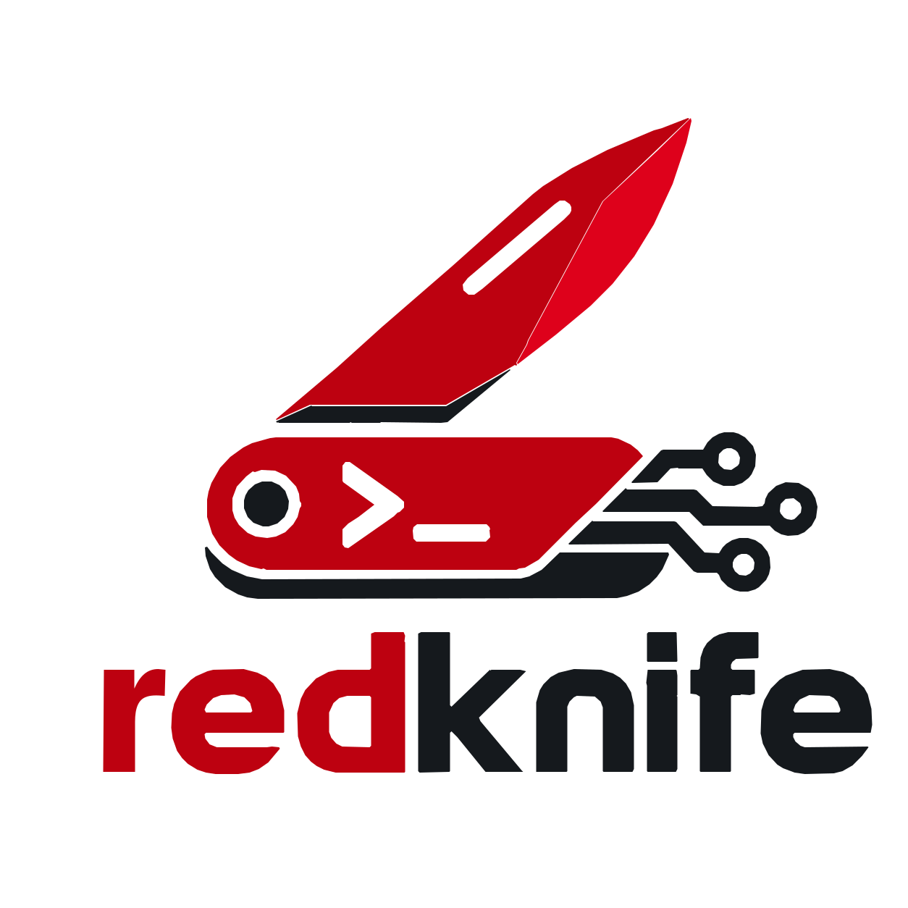

<p align="center">
  
</p>

<p align="center">
  <strong>A Swiss Army knife for offensive security.</strong>
</p>

## Features

- **ARP**
  - **ARP Spoofing**: Poison ARP caches.

- **FTP**
  - **FTP Server**: A minimal FTP server.

- **HTTP**
  - **HTTP Callback Server**: Receive and log incoming HTTP requests.
  - **HTTP Proxy**: Inspect, intercept, modify, and forward/drop HTTP requests.
  - **HTTP Send**: Send and replay HTTP and HTTPS requests.

- **LDAP**
  - **LDAP Server**: A minimal LDAP server (i.e., for capturing credentials via LDAP pass-back attacks).

## Install

**Get compiled artifact from releases**

Download the archive for your architecture from [GitHub Releases](https://github.com/yukibtc/redknife/releases).

Optionally, before extracting the archive, verify its signature and checksum. 
Download `SHA256SUMS` and `SHA256SUMS.asc` from the same release into the same directory and import the signing key listed in [SECURITY.md](SECURITY.md):

```bash
gpg --verify SHA256SUMS.asc SHA256SUMS
sha256sum --check --ignore-missing SHA256SUMS
```

Extract the downloaded archive and run `rk`:

```bash
tar -xzf rk-<version>-<target>.tar.gz
./rk --help
```

Optionally, install `rk` system-wide to run it from any directory (requires `sudo`):

```bash
sudo install -m 755 rk /usr/local/bin/rk
```

or user-wide (ensure `~/.local/bin` is in your `PATH`):

```bash
install -m 755 rk ~/.local/bin/rk
```

**Install using cargo from git**

```bash
cargo install redknife --git https://github.com/yukibtc/redknife
```

## Usage

Show the available commands and general options:

```bash
rk --help
```

## Changelog

All notable changes are documented in the [CHANGELOG.md](CHANGELOG.md).

## State

redknife is still in early development! Features and APIs will change, and bugs are expected.

## Disclaimer

redknife is intended for educational purposes and authorized security testing only. Use it only on systems you own or have explicit permission to test.

## License

This project is distributed under the MIT software license – see the [LICENSE](LICENSE) file for details
